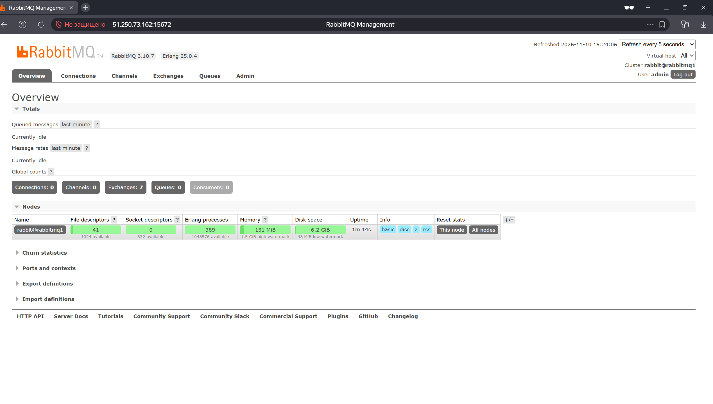
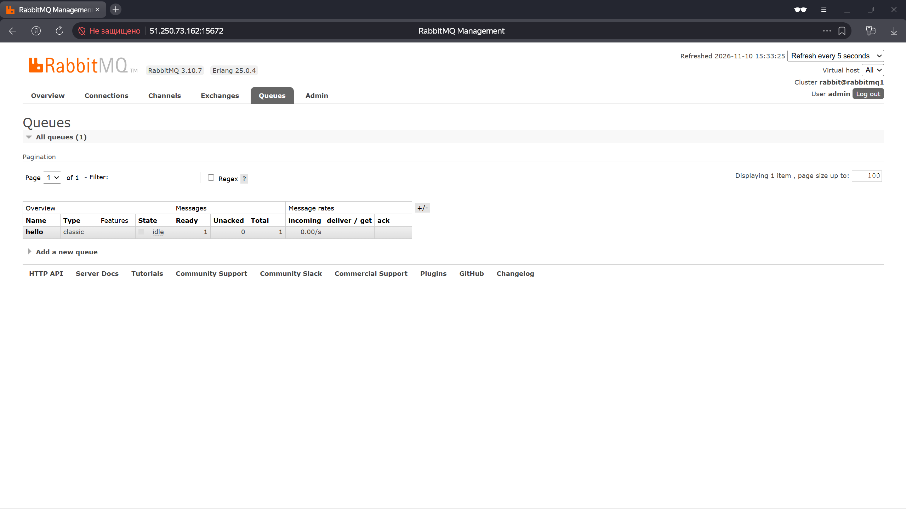
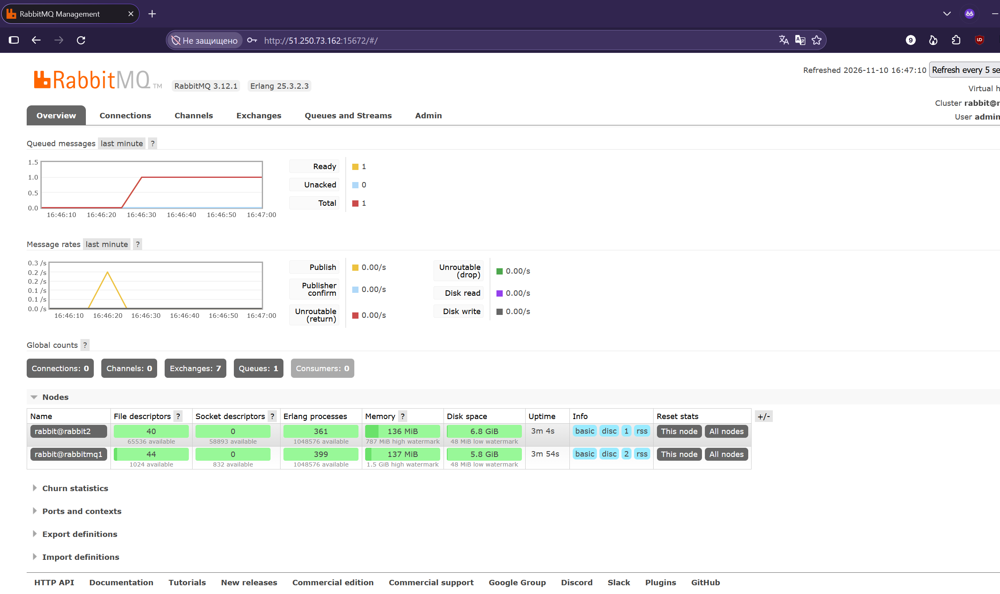
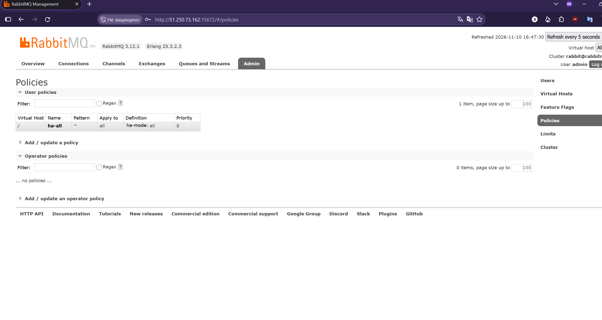
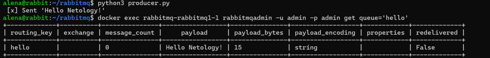
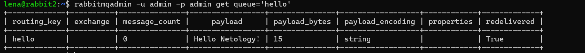

# Домашнее задание к занятию "`Очереди RabbitMQ`" - `Павлова Алена`


---

## Задание 1. Установка RabbitMQ
Скриншот веб-интерфейса RabbitMQ Management:


---

## Задание 2. Отправка и получение сообщений
Скриншот очереди `hello` в веб-интерфейсе (сообщение отправлено):


Скриншот результата работы скрипта `consumer.py` (сообщение получено):


---

## Задание 3. Подготовка HA кластера
Скриншот веб-интерфейса с доступными нодами в кластере:


Скриншот веб-интерфейса с включенной политикой `ha-all`:


Вывод команды `cluster_status` с первой ноды:
```bash
Cluster status of node rabbit@rabbitmq1 ...
Basics

Cluster name: rabbit@rabbitmq1
Total CPU cores available cluster-wide: 4

Disk Nodes

rabbit@rabbit2
rabbit@rabbitmq1

Running Nodes

rabbit@rabbit2
rabbit@rabbitmq1

Versions

rabbit@rabbit2: RabbitMQ 3.12.1 on Erlang 25.3.2.8
rabbit@rabbitmq1: RabbitMQ 3.12.1 on Erlang 25.3.2.3

CPU Cores

Node: rabbit@rabbit2, available CPU cores: 2
Node: rabbit@rabbitmq1, available CPU cores: 2

Maintenance status

Node: rabbit@rabbit2, status: not under maintenance
Node: rabbit@rabbitmq1, status: not under maintenance

Alarms

(none)

Network Partitions

(none)

Listeners

Node: rabbit@rabbit2, interface: [::], port: 15672, protocol: http, purpose: HTTP API
Node: rabbit@rabbit2, interface: [::], port: 25672, protocol: clustering, purpose: inter-node and CLI tool communication
Node: rabbit@rabbit2, interface: [::], port: 5672, protocol: amqp, purpose: AMQP 0-9-1 and AMQP 1.0
Node: rabbit@rabbitmq1, interface: [::], port: 15672, protocol: http, purpose: HTTP API
Node: rabbit@rabbitmq1, interface: [::], port: 15692, protocol: http/prometheus, purpose: Prometheus exporter API over HTTP
Node: rabbit@rabbitmq1, interface: [::], port: 25672, protocol: clustering, purpose: inter-node and CLI tool communication
Node: rabbit@rabbitmq1, interface: [::], port: 5672, protocol: amqp, purpose: AMQP 0-9-1 and AMQP 1.0

Feature flags

Flag: classic_mirrored_queue_version, state: enabled
Flag: classic_queue_type_delivery_support, state: enabled
Flag: direct_exchange_routing_v2, state: enabled
Flag: drop_unroutable_metric, state: enabled
Flag: empty_basic_get_metric, state: enabled
Flag: feature_flags_v2, state: enabled
Flag: implicit_default_bindings, state: enabled
Flag: listener_records_in_ets, state: enabled
Flag: maintenance_mode_status, state: enabled
Flag: quorum_queue, state: enabled
Flag: restart_streams, state: enabled
Flag: stream_queue, state: enabled
Flag: stream_sac_coordinator_unblock_group, state: enabled
Flag: stream_single_active_consumer, state: enabled
Flag: tracking_records_in_ets, state: enabled
Flag: user_limits, state: enabled
Flag: virtual_host_metadata, state: enabled
```
Вывод команды cluster_status со второй ноды:
```bash
Cluster status of node rabbit@rabbit2 ...
Basics

Cluster name: rabbit@rabbit2.ru-central1.internal
Total CPU cores available cluster-wide: 4

Disk Nodes

rabbit@rabbit2
rabbit@rabbitmq1

Running Nodes

rabbit@rabbit2
rabbit@rabbitmq1

Versions

rabbit@rabbit2: RabbitMQ 3.12.1 on Erlang 25.3.2.8
rabbit@rabbitmq1: RabbitMQ 3.12.1 on Erlang 25.3.2.3

CPU Cores

Node: rabbit@rabbit2, available CPU cores: 2
Node: rabbit@rabbitmq1, available CPU cores: 2

Maintenance status

Node: rabbit@rabbit2, status: not under maintenance
Node: rabbit@rabbitmq1, status: not under maintenance

Alarms

(none)

Network Partitions

(none)

Listeners

Node: rabbit@rabbit2, interface: [::], port: 15672, protocol: http, purpose: HTTP API
Node: rabbit@rabbit2, interface: [::], port: 25672, protocol: clustering, purpose: inter-node and CLI tool communication
Node: rabbit@rabbit2, interface: [::], port: 5672, protocol: amqp, purpose: AMQP 0-9-1 and AMQP 1.0
Node: rabbit@rabbitmq1, interface: [::], port: 15672, protocol: http, purpose: HTTP API
Node: rabbit@rabbitmq1, interface: [::], port: 15692, protocol: http/prometheus, purpose: Prometheus exporter API over HTTP
Node: rabbit@rabbitmq1, interface: [::], port: 25672, protocol: clustering, purpose: inter-node and CLI tool communication
Node: rabbit@rabbitmq1, interface: [::], port: 5672, protocol: amqp, purpose: AMQP 0-9-1 and AMQP 1.0

Feature flags

Flag: classic_mirrored_queue_version, state: enabled
Flag: classic_queue_type_delivery_support, state: enabled
Flag: direct_exchange_routing_v2, state: enabled
Flag: drop_unroutable_metric, state: enabled
Flag: empty_basic_get_metric, state: enabled
Flag: feature_flags_v2, state: enabled
Flag: implicit_default_bindings, state: enabled
Flag: listener_records_in_ets, state: enabled
Flag: maintenance_mode_status, state: enabled
Flag: quorum_queue, state: enabled
Flag: restart_streams, state: enabled
Flag: stream_queue, state: enabled
Flag: stream_sac_coordinator_unblock_group, state: enabled
Flag: stream_single_active_consumer, state: enabled
Flag: tracking_records_in_ets, state: enabled
Flag: user_limits, state: enabled
Flag: virtual_host_metadata, state: enabled
```
Скриншот выполнения `rabbitmqadmin get queue='hello'` на первой ноде:


Скриншот выполнения `rabbitmqadmin get queue='hello'` на второй ноде:


Скриншот работы `consumer.py` на второй ноде после отключения первой (доказательство отказоустойчивости):


